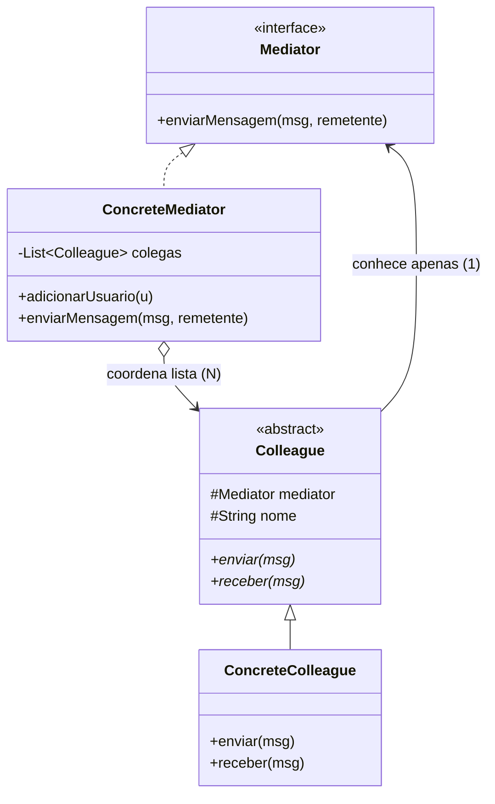

# 🎓 Laboratório de Estudo em Java: Design Pattern Mediator (GoF)

Este projeto foi construído especificamente para acompanhar **todos os 25 slides** da aula de **Engenharia de Software • Padrões GoF: Design Pattern Mediator**, servindo como guia prático de estudo, revisão para provas e laboratório de código para você e seus colegas.

---

## 📂 Estrutura do Projeto e Mapeamento com os Slides

```text
EstudoPadraoMediator/
├── README.md                                  # Guia completo de estudos + UML + Exercícios
└── src/
    ├── MainEstudoMediator.java                # Menu Interativo + Resumo Teórico + Quiz de Revisão
    ├── antipadrao/                            # [Slides 05, 06, 11, 12, 13]
    │   ├── UsuarioAcoplado.java               # O Anti-Padrão: Lista de contatos dentro do usuário
    │   └── MainAcoplado.java                  # Demonstração do caos N x N
    ├── chat/                                  # [Slides 08, 09, 14 a 19] Exemplo 01: Sala de Chat
    │   ├── ChatMediator.java                  # 1. Mediator (Interface)
    │   ├── SalaDeChat.java                    # 2. ConcreteMediator
    │   ├── Usuario.java                       # 3. Colleague (Classe Abstrata)
    │   ├── UsuarioChat.java                   # 4. ConcreteColleague
    │   └── MainMediator.java                  # Passo 5: Teste prático 1 x N
    ├── smarthome/                             # [Slides 02, 10, 22, 23] Exemplo 02: Smart Home (IoT)
    │   ├── SmartHomeMediator.java             # 1. Mediator (Interface)
    │   ├── HubSmartHome.java                  # 2. ConcreteMediator (Coordena cenas da casa)
    │   ├── Dispositivo.java                   # 3. Colleague (Classe Abstrata)
    │   ├── Despertador.java                   # 4. ConcreteColleague (Gatilho de eventos)
    │   ├── SensorPresenca.java                # 4. ConcreteColleague (Gatilho de eventos)
    │   ├── Cafeteira.java                     # 4. ConcreteColleague (Atuador)
    │   ├── CortinaAutomatizada.java           # 4. ConcreteColleague (Atuador)
    │   ├── ArCondicionado.java                # 4. ConcreteColleague (Atuador)
    │   ├── LuzInteligente.java                # 4. ConcreteColleague (Atuador)
    │   └── MainSmartHome.java                 # Simulação do Ciclo de Vida (Passos 1, 2 e 3)
    └── trafegoaereo/                          # [Slide 07] Exemplo 03: Controle de Tráfego Aéreo
        ├── TorreMediator.java                 # 1. Mediator (Interface)
        ├── TorreDeControle.java               # 2. ConcreteMediator (Gerencia pista e fila de espera)
        ├── Aeronave.java                      # 3. Colleague (Classe Abstrata)
        ├── VooComercial.java                  # 4. ConcreteColleague
        └── MainTrafegoAereo.java              # Simulação de disputa de pista coordenada pela Torre
```

---

## 🚀 Como Compilar e Executar

Você pode abrir a pasta `EstudoPadraoMediator` diretamente no **IntelliJ IDEA**, **Eclipse** ou **VS Code**, ou rodar pelo terminal:

### Pelo Terminal (PowerShell / CMD)

```powershell
# 1. Entre na pasta do projeto
cd C:\Users\Adriann\Desktop\EstudoPadraoMediator

# 2. Compile todos os arquivos para a pasta bin/
javac -encoding UTF-8 -d bin src/antipadrao/*.java src/chat/*.java src/smarthome/*.java src/trafegoaereo/*.java src/MainEstudoMediator.java

# 3. Execute o Menu Interativo (inclui os 4 exemplos + Resumo Teórico + Quiz)
java -cp bin MainEstudoMediator

# (Opcional) Para rodar todas as demonstrações de uma só vez sem menu:
java -cp bin MainEstudoMediator --todos
```

> 💡 **Nota:** Você também pode executar o método `main` de cada módulo isoladamente (`antipadrao.MainAcoplado`, `chat.MainMediator`, `smarthome.MainSmartHome` ou `trafegoaereo.MainTrafegoAereo`).

---

## 🧠 Resumo Teórico Guiado pelos Slides

### 1. O Problema: O Caos do Acoplamento Direto (Slides 3 a 6)
* **Classificação GoF:** Padrão **Comportamental** (foco nas interações e responsabilidades entre objetos).
* **Definição Clássica (1994):** *"Define um objeto que encapsula a forma como um conjunto de objetos interage. O Mediator promove o acoplamento fraco ao evitar que os objetos se refiram uns aos outros explicitamente."*
* **Matemática do Acoplamento (Slide 6):**
  * **Sem Mediator ($N \times N$):** $\frac{N \times (N - 1)}{2}$ conexões diretas. Com **10 objetos**, são **45 conexões**!
  * **Com Mediator ($1 \times N$):** Apenas **$N$ conexões**. Com **10 objetos**, são apenas **10 conexões** com 1 objeto Mediator central.

---

### 2. Arquitetura UML e os 4 Participantes (Slides 8, 9 e 10)



| Participante UML | Papel na Arquitetura (Slide 9) | No Exemplo 01 (`chat`) | No Exemplo 02 (`smarthome`) | No Exemplo 03 (`trafegoaereo`) |
| :--- | :--- | :--- | :--- | :--- |
| **1. Mediator** | Interface que declara o contrato de comunicação | `ChatMediator` | `SmartHomeMediator` | `TorreMediator` |
| **2. ConcreteMediator** | Implementa a coordenação e guarda os colegas | `SalaDeChat` | `HubSmartHome` | `TorreDeControle` |
| **3. Colleague** | Classe abstrata que guarda a referência `#mediator` | `Usuario` | `Dispositivo` | `Aeronave` |
| **4. ConcreteColleague** | Classes reais do domínio que acionam o mediador | `UsuarioChat` | `Despertador`, `Cafeteira`, `CortinaAutomatizada`, etc. | `VooComercial` |

#### Ciclo de Vida de uma Notificação (Slide 10):
1. **Passo 1:** `Classe A` (ex: `Despertador`) sofre uma ação e invoca o método do `Mediator` (`mediator.notificar(this, "ALARME_MANHA")`).
2. **Passo 2:** `ConcreteMediator` (`HubSmartHome`) avalia o evento e aplica regras de roteamento.
3. **Passo 3:** `Mediator` aciona métodos específicos nos Colegas `B` e `C` (`cortina.abrir()`, `cafeteira.prepararCafe()`, `ar.ajustarTemperatura(23)`).

---

### 3. Análise Crítica, SOLID e Comparativos (Slides 20 a 24)

#### Onde o Mediator já existe no próprio Java SDK? (Slide 20)
* **`java.util.Timer`**: Métodos `schedule()` coordenam tarefas em background sem acoplamento entre elas.
* **`java.util.concurrent.ExecutorService`**: Gerencia a submissão e execução de múltiplos `Runnables` e `Callables`.
* **`Java Swing / JavaFX`**: `ButtonGroup` (garante que apenas 1 `JRadioButton` fique marcado sem um botão conhecer o outro) e Controllers MVC.

#### Mediator vs. Observer vs. Facade (Slide 21)

| Padrão | Direção da Comunicação | Objetivo Principal |
| :--- | :--- | :--- |
| **Mediator** | **Multidirecional (Centralizada)** | Eliminar conexões diretas entre colegas do mesmo nível. |
| **Observer** | **Unidirecional (Broadcast)** | Notificar assinantes dinamicamente sobre mudanças de estado. |
| **Facade** | **Unidirecional (Cliente → Subsistema)** | Apenas simplificar a interface de um subsistema complexo. |

#### Alinhamento com SOLID (Slide 22) e O Perigo do "God Object" (Slide 23)
* **Single Responsibility (SRP):** Extrai toda a regra de interação para um único lugar isolado.
* **Open/Closed (OCP):** Crie novos mediadores ou colegas sem alterar uma linha dos componentes existentes.
* **Alto Reuso:** Botões, sensores ou usuários são facilmente reaproveitados em outros projetos.
* ⚠️ **Cuidado com o "God Object" (Objeto Deus):** Com o tempo, o `ConcreteMediator` pode acumular dezenas de regras `if/else` e virar um monólito difícil de manter. **Dica prática:** Combine o Mediator com o padrão **Command** ou **Observer** para mantê-lo enxuto!

---

## 🛠️ 3 Exercícios Práticos para o Grupo de Estudos

Para fixar o conteúdo na prática com seus colegas, tentem resolver estes 3 desafios diretamente no código:

1. **Desafio 1 (Fácil - Pacote `chat`):**
   * Crie uma nova classe `UsuarioBot extends Usuario` que, sempre que alguém enviar uma mensagem contendo a palavra `"ajuda"`, responda automaticamente na sala: `"Bot: Olá! Digite /suporte para abrir um chamado."`.
   * *Objetivo:* Perceber na prática o **Open/Closed Principle (Slide 22)** — você adicionará um novo participante inteligente sem alterar nenhuma linha de `UsuarioChat`!

2. **Desafio 2 (Médio - Pacote `smarthome`):**
   * Crie um novo colega `SensorFumaca extends Dispositivo` com o método `detectarFumaca()` que envia o evento `"ALERTA_INCENDIO"`.
   * No `HubSmartHome`, adicione a regra para `"ALERTA_INCENDIO"`: desligar a `Cafeteira`, desligar o `ArCondicionado`, abrir a `CortinaAutomatizada` e acender a `LuzInteligente` em `100%`.

3. **Desafio 3 (Avançado - Slide 23 "Evitando o God Object"):**
   * No pacote `smarthome`, refatore o `switch (evento)` de `HubSmartHome` usando o padrão **Command**: crie uma interface `RotinaCommand { void executar(); }` e substitua os `case` por um `Map<String, RotinaCommand>` registrado dinamicamente.
